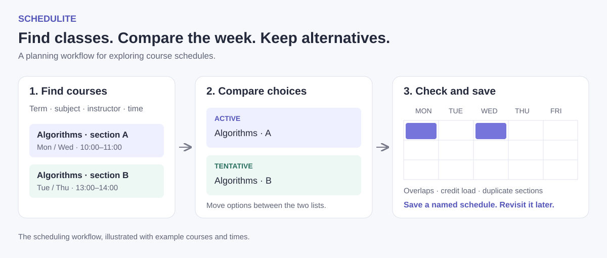

# ScheduLite

ScheduLite is a course-scheduling prototype that helps students search for classes, compare possible schedules, and see how their choices fit together during the week.



*The scheduling workflow, illustrated with example courses and meeting times.*

## Motivation

Building a class schedule involves more than finding courses that sound interesting. Sections meet at different times, classes overlap, and changing one choice can affect the rest of the week. It can be especially difficult for students who are still learning how to navigate a course catalog.

We wanted to make that process easier to explore. Instead of moving between a catalog, a calendar, and a separate list of backup choices, students can keep those pieces together and compare alternatives as they go.

The goal was class scheduling optimization through a clearer planning workflow. Students can compare alternatives and adjust their choices to find a schedule that works for them.

The project reached **Technology Readiness Level 5 (TRL 5)** during development.

## Planning a schedule

1. **Find courses.** Search the catalog and filter by term, course prefix, number, title, instructor, meeting time, or day. Open a course to inspect its details.
2. **Keep options open.** Active courses form the current schedule. Tentative courses hold alternatives without committing them to the calendar.
3. **Compare the week.** The calendar shows active courses together. The interface flags time overlaps, duplicate sections, and credit loads above 18 hours. Move courses between active and tentative lists while considering different combinations.
4. **Save alternatives.** Create named schedules for a semester and year, then return to them from the schedule-selection page.

## How it works

The repository contains two applications:

| Part | Implementation | Responsibility |
| --- | --- | --- |
| [Client](schedulite.clientapp) | React, TypeScript, Material UI, React Big Calendar | Course search, calendar interaction, active/tentative choices, and schedule management |
| [Web service](ScheduLite.webservice) | Java 11, Spring Boot, Gradle, MongoDB | Catalog queries, account authentication, and saved schedules |

The client keeps the current schedule in React context and sends catalog and account requests to the REST API. The web service stores course, user, role, and schedule information in MongoDB. Authentication uses JWTs.

Useful starting points are the [search screen](schedulite.clientapp/src/screens/SearchScreen/SearchPage.tsx), [schedule state and checks](schedulite.clientapp/src/context/ScheduleContext.tsx), [weekly calendar](schedulite.clientapp/src/screens/HomeScreen/Calendar/Calendar.tsx), and [catalog query service](ScheduLite.webservice/src/main/java/com/schedulite/schedulite/services/CourseService.java).

## Running locally

Use Node.js 18.15.0, npm 9.5.0, Java 11, and a MongoDB Atlas database with course and role data.

```sh
git clone https://github.com/TheDeafOne/ScheduLite.git
cd ScheduLite
```

Follow [INSTALL.md](INSTALL.md) to configure the database and local API address, then start the two applications in separate terminals:

```sh
# Backend, from the repository root
cd ScheduLite.webservice
sh ./gradlew bootRun
```

```sh
# Frontend, from the repository root
cd schedulite.clientapp
npm ci
npm start
```

Open [http://localhost:3000](http://localhost:3000). The API uses port 8080 by default.

Follow the installation guide to load a course catalog and point the client at your backend.
